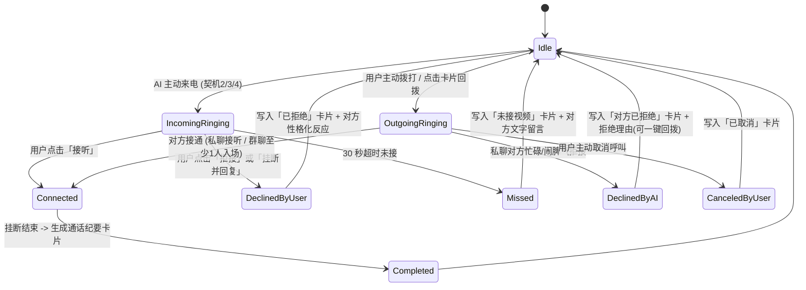

# Zoom 视频通话 3.0：通话契机、AI 主动来电、拒接/回拨与群聊角色互邀拒出镜 实施策划案

> **架构铁律**：严格遵循 **独立模块化引擎 + 轻量埋点接入**，严禁继续膨胀 `Milvus/app.min.js`。
> 本次 3.0 升级将全部复杂逻辑（来电契机检测、振铃与防骚扰状态机、拒接/未接/回拨流转、群聊点名拉人与性格化拒绝出镜）封装进独立新模块 `Milvus/video_call_invite_engine.js` 与现有 `Milvus/video_call_engine.js`；`Milvus/app.min.js` 仅需 **2 处极简埋点（总计 < 18 行）**；数据持久化全部复用独立 IndexedDB `milvus_video_call_idb`（升级至 v3），**零写入 `localStorage`**。

---

## 一、需求全景与体验设计

### 1.1 发起视频通话的 4 类自然契机

| 契机类型 | 发起方 | 触发场景 | 体验效果 |
| :--- | :--- | :--- | :--- |
| **契机 1：用户主动发起** | 用户 | 点击私聊/群聊工具栏摄像机图标；或在未接/拒接卡片上点「回拨」 | 进入真实感呼叫振铃态（可配置秒接或 2~3.5 秒振铃判定） |
| **契机 2：传讯对话自然升温** | AI 名士 | 文字聊天中情绪升温、想当面展示某物、急事求助/撒娇/训话，或用户提到“想见你/开视频” | AI 回复中附带协议标签 `[[VIDEO_CALL_INVITE:来电理由]]`，前端自动剥离标签并弹出顶部来电横幅 / 振铃界面 |
| **契机 3：鸿雁传书主动来电** | AI 名士（后台调度） | 复用 `Milvus/proactive_msg_engine.js` 的定时/沉默追问/混合触发与防骚扰风控 | 开启「允许偶发视频来电」后，按设定概率（默认 25%）由纯文字传讯升级为「名士主动视频来电」 |
| **契机 4：群聊内部拉会/点名** | 某位群名士 / 用户 | 群聊中某角色提议“开个视频会”，或视频会议进行中用户/名士点名拉其他人入镜 | 弹出「XXX 发起了群视频会议」来电横幅；会中支持点名邀请未出镜角色，对方按人设决定露脸、仅语音或拒绝出镜 |

---

### 1.2 接听、拒接、未接与回拨完整状态机（私聊 vs 群聊）



#### 私聊场景细节
- **AI 主动打来**：
  - 顶部弹出悬浮**来电横幅**（不强行打断当前阅读），点击可展开全屏来电界面；显示名士头像、来电理由（如 *“刚熬好药，想亲眼看你喝下去”*）、`接听` / `拒接` / `挂断并回一句话`（快捷项：“现在不方便”“在忙，晚点回你”“自定义输入”）。
  - **接听**：直接打开 `VideoCallEngine.openCall`，将 `callContext`（来电理由、发起方式）注入首轮 Prompt，名士顺着来电理由自然开场。
  - **拒接**：写入 `voice_call_record`（`callKind: "video"`, `status: "rejected_by_user"`）卡片到当页传讯；若用户附带了拒接理由或未附带理由，自动触发对方基于 6 项人设发来 1 条自然回应（例如体贴叮嘱、委屈追问或傲娇冷哼），进入正常上下文。
  - **30 秒未接**：自动停止振铃，写入 `status: "missed"` 卡片 + 对方 1 条文字留言。
- **用户主动打去 / 回拨**：
  - 支持在视频设置中切换「拟真振铃模式（默认开）」与「秒接模式」。
  - 拟真模式下：显示 1.8~3.5 秒呼叫中画面，轻量判定对方接听态度：
    - **约 88% 正常接通**（附带接通瞬间小动作，如“刚放下笔”“擦着头发接起”）。
    - **约 12%（仅在上下文明确在吵架/忙碌/生闷气等情境下触发）性格化拒接**：写入 `status: "rejected"` 卡片 + 1 条符合人设的拒接文字消息。
    - **防挫败兜底**：用户在 5 分钟内点击「回拨」第 2 次时，**100% 强制接通**（对方软化/无奈接起），绝不死锁。

#### 群聊场景细节：点名拉人与性格化拒绝出镜
- **四态参会模型（`attendanceState`）**：群聊每位成员在会议中拥有独立状态，不再机械全员同时露脸：
  1. `joined_camera`：**已入场 · 露脸出镜**（正常占据 2×2 分页画格，支持自定义出镜图与背景）。
  2. `joined_audio_only`：**已入场 · 关镜头仅语音**（画格保留在分页中，头像微暗并标注 `📷 已关闭摄像头 · 仅语音`，附带角色理由标签，如“衣冠不整，只听诸君议事”；照常参与发言）。
  3. `declined`：**已拒绝出镜 / 未参会**（不占用 2×2 活跃视频格，收纳至顶部 `👥 成员 (X/N)` 抽屉的「未出镜」列表，展示拒绝理由，如“军务繁忙，恕不奉陪”）。
  4. `inviting`：**呼叫拉人中**（持续 1.5~2.5 秒脉冲动画，等待被邀者表态）。
- **开场自动分流**：
  - 群视频接通瞬间，引擎基于所有群成员的 **6 项完整配置（姓名/ID、MBTI、星座、语言风格、性格特点、个人背景）+ 用户身份配置库 + 开启的世界书 + 近期群聊上下文**，通过 **1 次批量结构化 LLM 请求**（超时 3.5 秒则降级到本地 MBTI 规则引擎）判定每位成员的初始参会状态与一句话理由。
  - **保底机制**：无论怎么判定，始终保证至少 1~2 位成员处于 `joined_camera` 或 `joined_audio_only`，绝不出现空房冷场；同时在成员抽屉顶部提供「一键全员出镜」按钮，满足用户想直接看全员的需求。
- **会中角色互邀（A 邀请 B，B 可同意或拒绝出镜）**：
  - 点击顶部 `👥 成员` 按钮打开参会抽屉，针对任何 `declined`（未出镜）或 `joined_audio_only`（未开镜头）的角色，用户可以选择：
    - **「我来邀请」**：以用户身份点名拉他入镜/开摄像头；
    - **「让某位已入场名士去叫」**（下拉选择已入场的名士 A，如让杨修去叫陆逊，或让张仲景催孙策开镜头）。
  - 引擎将「邀请人 A 的人设 + 被邀人 B 的 6 项人设 + 群聊上下文 + 当前会议对话」拼装后请求 LLM，生成两段互动：
    1. 邀请人 A 的喊话（如 *“[杨修] 喂，伯言，别躲在屏风后面装忙了，殿下叫你露个脸。”*）；
    2. 被邀人 B 的真实表态：`accept_camera`（妥协露脸，画格立刻亮起并可跳转至其所在分页）/ `accept_audio`（只肯开麦旁听）/ `reject`（继续高冷/害羞/嘴硬拒绝出镜并回怼邀请人）。
  - 所有邀请与拒绝互动都会实时显示在实时字幕、会议聊天记录，并在挂断后同步归档进传讯卡片与主线上下文。

---

## 二、模块化架构与文件改动清单

### 2.1 新增独立模块：`Milvus/video_call_invite_engine.js`
暴露全局接口 `window.VideoCallInviteEngine`，内部完全自包含：
1. **IndexedDB 存储扩展（复用 `milvus_video_call_idb` v3）**：
   - 新增 ObjectStore `call_invite_state`（按 `chatId` 记录 `lastInviteAt`、`dailyInviteCount`、`consecutiveCallAttempts`、`ringingMode`、`allowProactiveVideo`、`proactiveVideoChance`）。
   - **零 `localStorage` 写入**（仅只读读取主 `api_configs` 与 `user_personas`）。
2. **协议标签解析与防刷屏守门器**：
   - `extractInviteTag(text)`：从 AI 文本中提取 `[[VIDEO_CALL_INVITE:理由]]` 或 `[[GROUP_VIDEO_INVITE:发起人|理由]]`，返回 `{ cleanText, invite }`。
   - `canTriggerIncomingCall(chatId)`：检查互斥锁（当前是否已在视频通话/振铃中）、单会话 15 分钟冷却、免打扰时段（复用 `ProactiveMsgEngine` 免打扰配置）与每日主动来电上限（默认 3 次/天）。
3. **全局来电振铃 Portal（`z-index: 99999`）**：
   - **紧凑来电横幅**（页面顶部滑入，显示头像/群名、来电理由、接听/拒接/展开）。
   - **全屏来电 / 呼叫振铃页**（接听、拒接、挂断并附快捷理由、30 秒倒计时、Web Audio 柔和铃声 + 移动端震动）。
4. **AI 决策器**：
   - `decidePrivateOutgoingOutcome(chatData, roleplayBundle, attemptCount)`：私聊主动拨打接听/拒接判定（第 2 次回拨强制接通）。
   - `decideGroupInitialAttendance(chatData, members, roleplayBundle, initiator)`：单次批量判定群成员入场态（`joined_camera` / `joined_audio_only` / `declined` + 理由），附 3.5s 超时本地降级器。
   - `requestMemberInviteTurn({ inviter, target, chatData, roleplayBundle, transcript })`：处理「角色 A 邀请角色 B 出镜」的双向对话与状态变更。
5. **传讯卡片写入器**：
   - 统一通过 `window.chatHistoryStore.appendMessage` 写入 `voice_call_record`（`callKind: "video"`, `status: "missed" | "rejected" | "rejected_by_user" | "canceled"`），并触发 `milvus-video-call-saved` 事件刷新当前传讯页。

### 2.2 升级现有模块：`Milvus/video_call_engine.js`
1. `openCall(...)` 新增可选参数 `callContext`（`{ triggerSource, inviteReason, initiatorName, initialMemberStates, isCallback }`）：
   - 首轮开场字幕与 Prompt 自动衔接 `inviteReason` 与 `initiatorName`。
2. 群聊画格支持三态渲染：
   - `joined_camera`：正常显示头像/自定义出镜图 + 背景。
   - `joined_audio_only`：画格灰化蒙层 + `📷 已关闭摄像头 · 仅语音` + 理由角标，仍可正常发言与绿框高亮。
   - `declined`：自动过滤出 2×2 主画格，移入顶部 `👥 成员` 抽屉。
3. 顶部栏新增 `👥 成员 (X/N)` 抽屉（仅群聊显示）：
   - 列出「已出镜」「仅语音」「未出镜/已拒绝」三组名单与理由；
   - 对未出镜/仅语音成员提供「📣 我来邀请」与「🗣️ 让 [选择已入场名士] 去叫」双模式拉人；
   - 提供「✨ 一键全员出镜」覆盖开关；
   - 底部设置区新增「拟真呼叫振铃」开关。

### 2.3 轻量联动：`Milvus/proactive_msg_engine.js`（约 15 行）
- 在 `DEFAULT_CHAT_CONFIG` 新增 `allowVideoCallInvite: false`、`videoCallChance: 25`（百分比）。
- 在 `ProactiveMsgSettingsCard` 增加对应开关项。
- 在 `triggerProactiveForChat` 生成内容前/后，若开启 `allowVideoCallInvite` 且命中概率且 `VideoCallInviteEngine.canTriggerIncomingCall(chatId)` 通过，则转为触发 `VideoCallInviteEngine.receiveIncomingCall(...)`。

### 2.4 极简埋点：`Milvus/app.min.js`（严格 ≤ 18 行）
1. **工具栏摄像机按钮**：优先走 `VideoCallInviteEngine.startOutgoingCall(...)`（降级回退 `VideoCallEngine.openCall(...)`），实现拟真呼叫振铃与群聊开场入场分流。
2. **`voice_call_record` 卡片渲染处**（第 117628 行附近）：当 `msg.callKind === "video"` 且 `msg.status` 为 `missed` / `rejected` / `rejected_by_user` / `canceled` 时，右侧显示一个轻量 `回拨` 按钮，点击调用 `VideoCallInviteEngine.startOutgoingCall({ chatData, isGroup, isCallback: true, ... })`。
3. **AI 文本回复监听点**（`ChatDetail` 收到新回复后）：调用 `VideoCallInviteEngine.inspectAiReplyForInvite(chatData, replyMsg)`，若命中 `[[VIDEO_CALL_INVITE:...]]` 则触发来电横幅。

### 2.5 脚本挂载：`index.html`
在 `video_call_engine.js` 之后、`app.min.js` 之前挂载：
```html
<script src="Milvus/video_call_whiteboard.js?v=1795700000000"></script>
<script src="Milvus/video_call_engine.js?v=1795700000003"></script>
<script src="Milvus/video_call_invite_engine.js?v=1795700000000"></script>
<script src="Milvus/app.min.js?v=1795700000003"></script>
```

---

## 三、关键技术难点与潜在问题解决方案

| 潜在问题 | 根因分析 | 技术解决方案 |
| :--- | :--- | :--- |
| **1. 浏览器拦截自动播放铃声** | 移动端 Safari/Chrome 的 Autoplay Policy 禁止未交互页面的音频播放 | 使用 Web Audio API 合成柔和双音振铃；仅在 `AudioContext.state === "running"` 或用户手势后发声，被拦截时静默降级为顶部脉冲横幅 + `navigator.vibrate([200, 120, 200])`，零报错 |
| **2. AI 滥用标签导致疯狂来电骚扰** | 仅靠 Prompt 约束容易在连续几轮重复输出邀请标签 | 硬编码四重闸门：单会话 15 分钟冷却 + 每日上限 3 次 + 通话/振铃互斥锁 + 免打扰时段拦截；未通过闸门时只剥离标签保留自然文字，不弹振铃 |
| **3. 群聊入场判定太慢导致呼叫卡顿** | 若逐个成员请求 LLM，6 人群需 6 次请求耗时 >15 秒 | 合并为 **单次轻量批量 JSON 请求**（`max_tokens: 260`），并设 **3.5 秒超时竞速**（`Promise.race`）；超时或 JSON 异常自动降级到本地 MBTI（I/E 倾向）+ 稳定保底策略，确保 3.5 秒内必进房间 |
| **4. 群聊全员拒绝出镜导致冷场** | 多个高冷/内向人设同群时，LLM 可能全判拒绝 | 强制后处理保底：若 `joined_camera + joined_audio_only === 0`，自动将发起人或首位成员提升为 `joined_camera`；同时提供「一键全员出镜」手动覆盖开关 |
| **5. 拒接/未接/拒绝出镜后上下文断层** | 通话外状态若不写回传讯记录，下轮聊天 AI 会失忆 | 拒接/未接/取消均写入 `voice_call_record` 卡片并附带 `declineReason` / `missedNote`；`app.min.js` 原有上下文组装逻辑会自动将 `voice_call_record` 摘要注入下一轮对话历史 |
| **6. 正在通话时收到另一会话来电** | 鸿雁传书后台定时器可能在通话中触发其他名士来电 | `VideoCallInviteEngine` 维护全局 `_busyState` 锁；通话/白板/振铃中收到新来电自动转为「未接视频通话」卡片 + 顶部轻提示，绝不顶掉当前 Zoom 画面 |

---

## 四、分阶段实施计划

### Phase 0：核心引擎与纯模块研发（零改动 `app.min.js` 与 `index.html`）
1. 新建 `Milvus/video_call_invite_engine.js`：实现 IDB v3 `call_invite_state`、来电协议解析、防骚扰四重闸门、来电横幅与全屏振铃 Portal、Web Audio 柔和铃声、私聊接听/拒接/回拨判定、群聊单次批量入场分流与角色互邀决策器。
2. 升级 `Milvus/video_call_engine.js`：接入 `callContext`、支持群聊三态画格渲染（露脸 / 仅语音 / 已拒绝）、新增顶部 `👥 成员` 抽屉（含「我来邀请」「让某名士去叫」「一键全员出镜」）与拟真振铃设置开关。
3. 编写并运行 Node 自动化测试：验证标签解析、15 分钟冷却与互斥锁、第 2 次回拨强制接通、群聊全员拒接保底、批量入场超时降级、零 `localStorage.setItem` 写入、`node --check` 语法检查。

### Phase 1：轻量埋点与全链路联调
1. 在 `Milvus/proactive_msg_engine.js` 增加「允许偶发视频来电」配置项与触发桥接。
2. 在 `Milvus/app.min.js` 落入 2~3 处极简埋点（< 18 行）：工具栏接入 `startOutgoingCall`、未接/拒接视频卡片新增「回拨」按钮、AI 回复文本触发 `inspectAiReplyForInvite`。
3. 在 `index.html` 挂载 `video_call_invite_engine.js` 并更新脚本版本号。
4. 执行全量语法校验与集成验收。

---

> 请审阅以上策划案。确认无误后请回复 **「开始实施 Phase 0」**，我将先完成独立引擎开发与全套自动化单元测试。
